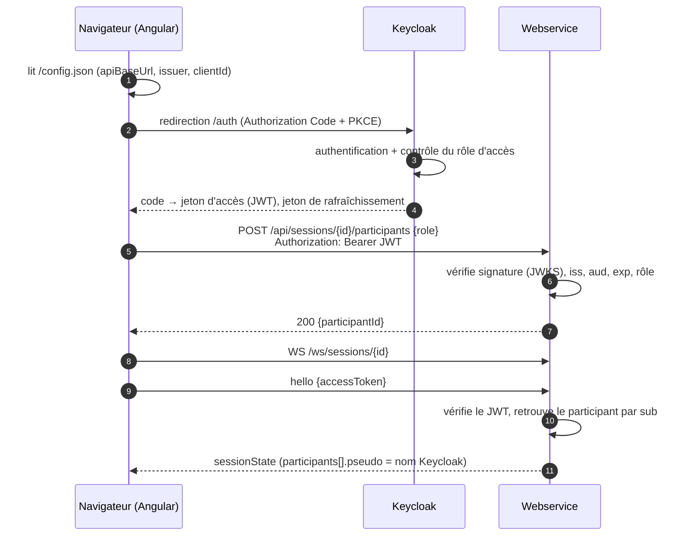

# Analyse : connexion des utilisateurs par Keycloak

- **Date :** 2026-10-13
- **Statut :** document de réflexion, pour se poser les bonnes questions avant un éventuel passage à Keycloak. **Aucune implémentation n'est prévue à date.**
- **Contexte :** Keycloak ne serait mis en place que lors d'un déploiement en **environnement d'entreprise** (OpenShift). Dans ce cas, Render est abandonné.
- **Besoin :**
  1. l'utilisateur se connecte par Keycloak, et Keycloak indique s'il a accès à l'application ;
  2. son **nom et prénom** (venus de Keycloak) s'affichent à la place du pseudo saisi.
- **Décisions déjà prises :** voir § 11.

---

## 1. Synthèse

| Point | Aujourd'hui | Avec Keycloak |
| --- | --- | --- |
| Accès | Anonyme, « sans compte » | Connexion obligatoire (OIDC, Authorization Code + PKCE) ; Keycloak indique si l'utilisateur a accès à l'application |
| Identité d'un participant | Pseudo saisi + `participantToken` (secret par session, dans le `localStorage`) | Identifiant Keycloak `sub`, prouvé par le jeton d'accès (JWT) |
| Nom affiché | Pseudo saisi, 1 à 20 points de code, unique dans la session (casse ignorée) | « Nom Prénom », construit à partir des claims `family_name` et `given_name` du jeton (repli : `preferred_username`), jamais saisi |
| Unicité | Par pseudo (`PSEUDO_TAKEN`) | Par `sub` : deux homonymes sont deux participants distincts |
| Reprise depuis un autre appareil (FR-8) | Rejoindre avec le pseudo d'un participant déconnecté, révocation de l'ancien jeton | Automatique : le même utilisateur retrouve sa place sur tous ses appareils |
| REST | Sans authentification | `Authorization: Bearer <jeton d'accès>` sur tout `/api/**` sauf `/api/health` |
| WebSocket | `hello {participantToken}` | `hello {accessToken}` (un navigateur ne peut pas poser d'en-tête sur un WebSocket) |

Le changement touche les **quatre couches** (Keycloak, contrat, webservice, front), plus les tests, le déploiement et les documents de cadrage (PRD, architecture). C'est une évolution de rupture : il faut un **nouvel AD** qui remplace AD-7 et un déploiement coordonné (§ 9).

**Recommandation principale :** faire de `sub` l'identité du participant et **supprimer le `participantToken`** (option B, § 4). Le garder (option A) coûte presque aussi cher et laisse deux mécanismes d'identité à maintenir.

---

## 2. Flux cible



Deux niveaux de contrôle du droit d'usage :

1. **Keycloak** refuse la connexion à qui n'a pas le rôle (politique d'accès du client, ou flux d'authentification avec condition sur le rôle) : l'utilisateur ne revient même pas dans l'application.
2. **Le webservice** revérifie le rôle dans chaque jeton (REST et `hello`) : c'est la seule barrière qui compte vraiment, le front pouvant être contourné.

---

## 3. Keycloak (configuration, pas de code)

| Élément | Réglage proposé |
| --- | --- |
| Realm | celui de l'entreprise (à confirmer) |
| Client front | `planning-poker`, **public** (pas de secret dans un SPA), *Standard flow* seul, PKCE `S256` obligatoire, *Direct access grants* et *Implicit flow* désactivés |
| Redirect URIs | `https://<front>/*` (et `http://localhost:4200/*` pour le développement local, dans un realm de dev) |
| Web origins | `https://<front>` (CORS de l'endpoint de jeton) |
| Accès à l'application | **Décidé : c'est Keycloak qui indique si l'utilisateur a accès** (utilisateur ou groupe AD/LDAP affecté à l'application). À valider avec l'équipe Keycloak : sous quelle forme cet accès apparaît dans le jeton (par exemple un rôle client `planning-poker:user`), pour que le webservice puisse le revérifier. |
| Audience | *Audience mapper* ajoutant `planning-poker-api` dans `aud`, pour que le webservice n'accepte pas un jeton émis pour une autre application |
| Claims | `family_name` (nom) et `given_name` (prénom), scope `profile`, normalement alimentés par l'annuaire : **à valider** ; `preferred_username` en repli ; les rôles clients sont dans `resource_access.planning-poker.roles` |
| Durées | jeton d'accès 5 min (défaut), session SSO ≥ durée d'un atelier (2 h à 8 h) ; rafraîchissement par *refresh token*, pas par iframe |
| Refus d'accès | *Client policy* / flux d'authentification conditionnel « rôle requis » : l'utilisateur sans rôle voit l'écran de refus de Keycloak |

**Création de session (décidé) :** pas de rôle « animateur » dans Keycloak. L'animateur est celui qui ouvre l'**URL de départ** (page d'accueil, qui crée la session) ; les participants arrivent par le **lien de session** (`/s/{sessionId}`), qui ne propose que de rejoindre. C'est déjà le fonctionnement actuel : rien à changer. À savoir : l'URL de départ n'est pas secrète, donc tout utilisateur qui a accès à l'application et la connaît peut créer une session. Si un jour il faut vraiment restreindre la création, il faudra un rôle Keycloak dédié.

---

## 4. Choix de conception : que devient le `participantToken` ?

### Option A — on garde le `participantToken`, on ajoute le JWT

- REST et `hello` portent les deux ; le serveur vérifie que `jwt.sub == participant.userId`.
- Peu de changement dans le front de session, mais deux identités à garder cohérentes, la logique de reprise par pseudo devient absurde (le pseudo n'est plus saisi), et la révocation `4401` « ta place a été reprise » chasse le même utilisateur de son autre appareil.

### Option B — l'identité est `sub` (recommandée)

- Le `Participant` porte un `UserId` (le `sub`) à la place de `ParticipantToken`.
- `POST /participants` devient **idempotent** : le même utilisateur qui rejoint deux fois retrouve sa place (même `participantId`, rôle, vote). Pas de jeton à révoquer, plusieurs appareils en même temps (AD-8 gère déjà plusieurs connexions).
- `hello {accessToken}` : session inconnue → `4404` ; JWT invalide ou expiré → nouveau code `4440` ; rôle absent → nouveau code `4403` ; utilisateur pas (ou plus) participant → `4401` (le front affiche « Rejoindre »).
- Retour après longue absence (FR-9) : le participant retiré est retrouvé par `sub`, sans le contrôle « pseudo repris entre-temps ».
- Disparaissent : `ParticipantToken`, `PseudoTakenException`, `PSEUDO_TAKEN`, `INVALID_PSEUDO`, la clé `pp.token.{sessionId}`, la reprise par pseudo.

La suite du document décrit l'option B.

---

## 5. Contrat (`contract/`, AD-6)

| Fichier | Modification |
| --- | --- |
| `openapi.yaml` | `securitySchemes.keycloak` (type `oauth2` / `openIdConnect`), `security` sur les trois endpoints de session ; `/api/health` reste public. Nouvelles réponses `401` (`UNAUTHENTICATED`) et `403` (`FORBIDDEN`) en `problem+json`. Suppression de `409 PSEUDO_TAKEN` et `400 INVALID_PSEUDO`. Le `participantToken` disparaît des réponses. |
| `schemas/create-session-request.json`, `join-session-request.json` | `pseudo` retiré de `required` (puis du schéma) : seuls `role` et `deck` restent. |
| `schemas/create-session-response.json`, `join-session-response.json` | `participantToken` retiré. |
| `schemas/hello.json` | `participantToken` remplacé par `accessToken` (chaîne JWT, `maxLength` ≈ 8 000). |
| `schemas/common.json` | `pseudo` (1 à 20) → nom affiché, 1 à **64** points de code (description « nom Keycloak normalisé ») ; `rawPseudo`, `participantToken` supprimés. On peut garder le nom de champ `pseudo` dans `session-state.json` pour limiter le diff, ou le renommer `displayName` (plus juste, mais tout le front et les exemples bougent). |
| `asyncapi.yaml` | Codes de fermeture `4403` (accès refusé) et `4440` (jeton d'accès invalide ou expiré : rafraîchir puis se reconnecter) ; `4401` redéfini (« pas participant de cette session »). |
| `examples/` | Supprimer `problem/pseudo-taken.json`, `problem/bad-request-invalid-pseudo.json` ; ajouter `problem/unauthenticated.json`, `problem/forbidden.json` ; mettre à jour les requêtes, réponses, `hello/hello.json` et les instantanés (noms complets). |

> AD-13 impose un contrat qui ne change que par ajout. L'authentification casse forcément les clients existants (un ancien front ne sait pas obtenir de jeton) : il faut l'acter dans le nouvel AD comme **exception unique**, avec un déploiement coordonné (§ 9).

---

## 6. Webservice (`backend/`)

### 6.1 Dépendances et configuration

- `pom.xml` : `spring-boot-starter-oauth2-resource-server` (Spring Security + Nimbus JOSE) ; en test, `spring-security-test`.
- `application.properties` (AD-12, uniquement par variables d'environnement) :

  ```properties
  spring.security.oauth2.resourceserver.jwt.issuer-uri=${KEYCLOAK_ISSUER_URI}
  planning-poker.auth.audience=${KEYCLOAK_AUDIENCE:planning-poker-api}
  planning-poker.auth.client-id=${KEYCLOAK_CLIENT_ID:planning-poker}
  planning-poker.auth.required-role=${KEYCLOAK_REQUIRED_ROLE:user}
  planning-poker.max-ws-message=16KB
  ```

  `max-ws-message` passe de 4 KB à 16 KB : un JWT Keycloak fait 1 à 3 KB, davantage avec beaucoup de rôles ou de groupes, et le `hello` le transporte. Sinon le conteneur ferme en `1009` et le client boucle en reconnexion.

### 6.2 Nouveau `config/SecurityConfig`

- `SecurityFilterChain` sans état : CSRF désactivé (jeton porteur, pas de cookie), `sessionManagement(STATELESS)`, `cors(withDefaults())` pour réutiliser la configuration CORS existante.
- Règles : `/api/health` → `permitAll` ; `/ws/**` → `permitAll` **au niveau HTTP** (l'authentification se fait dans le `hello`) ; `/api/**` → `hasAuthority("ROLE_" + requiredRole)` ; tout le reste refusé.
- `JwtAuthenticationConverter` personnalisé : lit `resource_access.<clientId>.roles` (et éventuellement `realm_access.roles`) pour produire les autorités.
- `JwtDecoder` avec validateurs : émetteur (`issuer-uri`), expiration (tolérance d'horloge 30 s), **audience** (`aud` contient `planning-poker-api`).
- Erreurs `401`/`403` en `application/problem+json` avec `code` `UNAUTHENTICATED` / `FORBIDDEN` (un `AuthenticationEntryPoint` et un `AccessDeniedHandler` alignés sur `RestErrorHandler`).
- `WebConfig.addCorsMappings` : ajouter `Authorization` à `allowedHeaders`.

### 6.3 Hexagone (AD-1 : le domaine reste pur)

| Couche | Modification |
| --- | --- |
| `domain` | Nouveau `UserId` (valeur opaque, le `sub`) ; `Pseudo` devient `DisplayName` (NFC, `strip`, 1 à 64 points de code, **tronqué** plutôt que refusé, `toString` sans la valeur ; plus de `uniquenessKey`). `Participant` : `UserId userId` à la place de `ParticipantToken token`, `withToken` supprimé. `Session.join` : retrouve le participant par `userId` (actif ou retiré) au lieu du pseudo ; plus de `PseudoTakenException` ; `participantWithToken` / `departedWithToken` → `participantOf(UserId)` / `departedOf(UserId)`. Le nom affiché est **mis à jour** à chaque entrée (il peut avoir changé dans l'annuaire). Suppression de `ParticipantToken`, `PseudoTakenException`, `InvalidPseudoException`. |
| `application` | Nouveau record `AuthenticatedUser(UserId id, DisplayName name)`, construit par les adaptateurs. `CreateSessionUseCase.create(user, role, deck)`, `JoinSessionUseCase.join(sessionId, user, role)`, `SessionConnectionUseCase.connect(sessionId, user, connectionId)`. `ConnectResult.UnknownToken` → `NotAParticipant`. Résultats sans `participantToken`. |
| `adapter.in.rest` | `SessionController` reçoit `@AuthenticationPrincipal Jwt jwt` et le traduit en `AuthenticatedUser` (un petit `JwtUsers` partagé avec le WebSocket : `sub` ; nom affiché `family_name` + `given_name` → `preferred_username` → `sub`). `CreateSessionRequest`/`JoinSessionRequest` sans `pseudo` ; `EntryRequests` simplifié. `CreationRateLimiter` : clé **par utilisateur** (`sub`) plutôt que par IP (plus juste derrière un proxy d'entreprise où tout le monde a la même IP). |
| `adapter.in.ws` | `SessionSocketHandler.handshake` : valide `hello.accessToken()` avec le `JwtDecoder` et le contrôle de rôle ; ferme en `4440` (invalide ou expiré) ou `4403` (rôle absent) avant d'appeler le cas d'usage. `ClientMessages.HelloMessage` : `accessToken`. |
| `config` | `SecurityConfig` (ci-dessus) ; `SessionConfig` inchangé hors signatures. |

### 6.4 Durée de vie du jeton et WebSocket

Le JWT est vérifié **au `hello`**, donc à chaque (re)connexion. Une connexion ouverte n'est **pas** fermée quand le jeton expire : c'est cohérent avec AD-8 (« l'inactivité ne déconnecte jamais ») et évite de couper un atelier toutes les 5 min.

**Cas concret (décision 5 du § 11) :** pendant un atelier, un administrateur retire dans Keycloak l'accès d'un participant (départ de l'entreprise, erreur d'affectation…). Ce participant est déjà dans la session, connecté. Que se passe-t-il ?

- **Sans développement supplémentaire (retenu)** : il reste dans la session tant que sa connexion tient. Le retrait ne prend effet qu'à sa **prochaine reconnexion** (coupure réseau, rechargement de la page, téléphone mis en veille), ou au plus tard quand la session disparaît (24 h). Il ne peut plus créer de session ni en rejoindre une autre.
- **Avec un développement supplémentaire** (environ 1 j, écarté) : le navigateur renvoie son nouveau jeton au serveur à chaque rafraîchissement (message `reauth {accessToken}`, toutes les quelques minutes). Quand Keycloak ne lui en délivre plus, le serveur le sort de la session en quelques minutes (fermeture `4440`).

**Décidé : option simple, rien à développer.** Pour un outil d'estimation en atelier, les données exposées (noms et votes de la séance) sont peu sensibles.

### 6.5 Confidentialité (NFR-6)

- Le nom Keycloak est une donnée personnelle, plus identifiante qu'un pseudo : même règle que le pseudo aujourd'hui, **jamais dans un journal** ; le `sub` et le JWT non plus.
- Les noms vivent en mémoire et disparaissent avec la session (24 h), comme aujourd'hui.
- Le `sub` ne sort jamais du webservice : l'instantané continue de désigner les participants par `participantId`.

---

## 7. Front (`frontend/`)

### 7.1 Bibliothèque

**`keycloak-js`** (adaptateur officiel, sans dépendance) enveloppé dans un `AuthService`. Le front n'utilise pas `HttpClient` mais `fetch` (`SessionApi`, `FETCH`) : les intercepteurs de `keycloak-angular` ou `angular-auth-oidc-client` n'apporteraient rien, il suffit d'obtenir un jeton frais avant chaque appel. Vérifier la compatibilité de version avec le serveur Keycloak de l'entreprise.

Réglages : `onLoad: 'login-required'`, `pkceMethod: 'S256'`, `checkLoginIframe: false` (pas d'iframe : cookies tiers bloqués par Safari, et la CSP n'aurait pas à ouvrir `frame-src`), jetons **en mémoire** uniquement (pas de `localStorage`).

### 7.2 Fichiers

| Fichier | Modification |
| --- | --- |
| `package.json` | + `keycloak-js` |
| `config/app-config.ts` | `AppConfig` : + `auth: { issuer, clientId }` ; validation (URL https de l'émetteur). |
| `scripts/write-config.mjs`, `scripts/api-base-url.mjs` | Lire `KEYCLOAK_URL`, `KEYCLOAK_REALM`, `KEYCLOAK_CLIENT_ID` ; les écrire dans `config.json` ; **CSP** : ajouter l'origine Keycloak à `connect-src` (endpoint de jeton). La redirection de connexion est une navigation, non soumise à `connect-src`. |
| `main.ts` | Après `loadAppConfig()`, `await auth.init()` (redirige vers Keycloak si besoin) **avant** `bootstrapApplication`, puis fournir `AuthService`. L'URL de la session (`/s/:id`) est conservée par le paramètre `redirectUri` / `state` : un lien partagé mène bien à la session après connexion. Erreur Keycloak → écran d'erreur dédié. |
| `auth/auth.service.ts` (nouveau) | `init()`, `token(): Promise<string>` (`updateToken(30)` puis jeton), `displayName` (« Nom Prénom » : `family_name` + `given_name`), `logout()`. |
| `api/session-api.ts` | `send()` ajoute `Authorization: Bearer` ; nouveaux genres d'erreur `unauthenticated` (401 : rafraîchir puis relancer une fois, sinon reconnexion Keycloak) et `forbidden` (403 : écran « Accès refusé ») ; `invalidPseudo` et `pseudoTaken` supprimés. |
| `api/contract.ts` (+ specs de contrat) | Types alignés sur le nouveau contrat (requêtes sans `pseudo`, réponses sans `participantToken`, `hello {accessToken}`, codes `4403`/`4440`). |
| `session/session.service.ts` | `hello` avec un jeton **frais** à chaque tentative (`await auth.token()`), donc aussi à chaque reconnexion ; `4440` → rafraîchir et retenter (pas une fin de session) ; `4403` → fin `forbidden` ; `4401` → fin `notParticipant` (écran Rejoindre, **sans** le message « place reprise »). Plus de lecture ni d'effacement du jeton de session. |
| `session/session-entry.component.ts` | Plus de jeton rangé : après `checkSession`, on tente directement la connexion ; `4401` → formulaire Rejoindre. `TAKEN_OVER_MESSAGE`, `PSEUDO_TAKEN_MESSAGE`, `INVALID_PSEUDO_MESSAGE` supprimés. |
| `home/home.component.ts` | Plus de pseudo à préremplir ni à mémoriser. |
| `entry-form/entry-form.component.ts`, `entry-messages.ts`, `styles/entry-form.css` | Champ « Ton pseudo » **supprimé**, remplacé par une ligne « Connecté en tant que **Nom Prénom** » ; le bouton n'attend plus que le rôle (et le jeu à la création). |
| `storage/browser-storage.ts` | Suppression de `pp.pseudo` et `pp.token.{sessionId}` (nettoyer les anciennes clés au démarrage) ; `pp.theme` reste. |
| `top-bar/participant-menu.component.ts` | Affiche déjà `me.pseudo` venu de l'instantané : rien à changer pour le nom ; ajouter l'entrée « Se déconnecter ». Prévoir l'ellipse pour un nom de 64 caractères (CSS de la barre et de `participant-table`). |
| `session/participant-table.component.ts`, `styles/table.css` | Noms plus longs : ellipse + `title` ; homonymes possibles (deux « Martin Julie ») : ils restent distincts par `participantId`, à départager visuellement si besoin (question ouverte). |
| `wake/` | Inchangé : `/api/health` reste public. L'écran de réveil s'affiche après la connexion Keycloak. |

### 7.3 Nouveaux écrans

- **Accès refusé** (403 du webservice ou `4403`) : « Tu n'as pas accès au Planning Poker. Demande l'accès à … », avec « Se déconnecter ».
- **Keycloak injoignable** : réutiliser l'écran « Le serveur ne répond pas » de `main.ts`.

Mettre à jour `EXPERIENCE.md` (parcours d'entrée) et `DESIGN.md` (bloc « Connecté en tant que »).

---

## 8. Tests

| Niveau | Impact |
| --- | --- |
| Domaine (JUnit) | Réécrire `PseudoTest` (→ `DisplayNameTest`), `SessionTakeOverTest`, `SessionAbsenceTest`, `SessionTest`, `ParticipantTest`, `SessionSnapshotTest` : identité par `UserId`, plus de pseudo pris ; ajouter « le même utilisateur rejoint deux fois », « homonymes distincts », « nom mis à jour au retour ». |
| Application | `CreateSessionUseCaseTest`, `JoinSessionUseCaseTest`, `SessionConnectionUseCaseTest` : signatures `AuthenticatedUser`. |
| REST (MockMvc) | `spring-security-test` : `jwt().authorities(...)` ; cas 401 sans jeton, 401 jeton expiré, 403 sans rôle, 403 mauvaise audience ; CORS avec `Authorization`. |
| WebSocket | `JwtDecoder` de test (clé RSA générée dans le test) : `hello` valide, expiré (`4440`), sans rôle (`4403`), non participant (`4401`), JWT de 8 KB accepté. |
| Contrat | Nouveaux exemples validés des deux côtés (`ContractRoundTripTest`, `WsContractRoundTripTest`, `contract.spec.ts`, `ws-contract.spec.ts`). |
| Architecture | `ArchitectureTest` : le domaine ne dépend ni de Spring Security ni de Nimbus. |
| Front (Vitest) | `AuthService` simulé ; specs de `session-api`, `session.service`, `session-entry`, `home`, `entry-form`, `browser-storage`, `app-config`, scripts `api-base-url` (CSP). |
| E2E Playwright | Les parcours UJ-1 à UJ-3 et `e2e/*` saisissent un pseudo (≈ 90 occurrences) : il faut un **Keycloak de test** (conteneur `quay.io/keycloak/keycloak` avec un realm importé et des utilisateurs de test, dans la CI) et une connexion par utilisateur dans `journey-helpers.ts` (formulaire Keycloak, ou état de stockage préparé). Ajouter un parcours « utilisateur sans rôle ». |
| Charge (`deploy/load-test.mjs`) | Obtenir des jetons pour 13 utilisateurs de test (client de test confidentiel avec *client credentials* ou comptes de service). |

---

## 9. Déploiement et exploitation

- **Variables** — webservice : `KEYCLOAK_ISSUER_URI`, `KEYCLOAK_AUDIENCE`, `KEYCLOAK_CLIENT_ID`, `KEYCLOAK_REQUIRED_ROLE` ; front : `KEYCLOAK_URL`, `KEYCLOAK_REALM`, `KEYCLOAK_CLIENT_ID` (→ `config.json`, ConfigMap sur OpenShift, AD-11). Mettre à jour le `README.md` et la documentation de déploiement.
- **Réseau** : le webservice doit joindre Keycloak (découverte OIDC et JWKS, mis en cache par Nimbus) ; au démarrage, `issuer-uri` est résolu, donc Keycloak doit répondre avant le webservice (ou utiliser `jwk-set-uri` pour un démarrage paresseux).
- **Cible (décidé)** : environnement d'entreprise (OpenShift), Render abandonné. Pas de mode anonyme à conserver : l'application exige toujours Keycloak, ce qui évite de doubler les chemins de code et les tests. En développement local, un Keycloak en conteneur (`docker compose`, realm de dev importé) remplace Render.
  - Les images sont déjà compatibles OpenShift (AD-12) ; `config.json` du front viendra d'une ConfigMap (AD-11). Restent à écrire les manifests OpenShift et le pipeline de l'entreprise (déjà listés en « Deferred » dans l'architecture), hors du périmètre de cette analyse.
  - Deviennent inutiles : `deploy/render.yaml`, `deploy/render-deploy.sh`, `.github/workflows/deploy.yml` et la partie Render de `deploy/README.md`.
  - Les mécanismes créés pour la mise en veille de Render (`heartbeat` client, appel de `/api/health` toutes les 5 min, écran de réveil) ne gênent pas mais ne servent plus : à garder ou simplifier plus tard, sans urgence.
  - La CI de l'entreprise (GitHub Actions ou GitLab CI, à confirmer) devra démarrer un Keycloak de test pour les tests de bout en bout.
- **Bascule** : rupture de contrat → déployer webservice **et** front ensemble, hors atelier (AD-13) ; les sessions en mémoire sont perdues au redémarrage, comme à tout déploiement.

---

## 10. Documents de cadrage à mettre à jour

- `README.md` : « sans compte » ne tient plus.
- PRD : FR-2 (rejoindre), FR-8 (reprise), NFR-6 (données personnelles), et une nouvelle exigence « accès réservé aux utilisateurs autorisés ».
- `ARCHITECTURE-SPINE.md` : nouvel **AD-14 « Identité déléguée à Keycloak »** qui remplace AD-7 ; amender AD-2 (surface : 401/403, codes WS), AD-11 (CSP et `config.json` avec Keycloak), AD-13 (exception de rupture de contrat) ; Stack (Spring Security, `keycloak-js`).
- UX : `EXPERIENCE.md` (entrée sans pseudo, écran Accès refusé, déconnexion), `DESIGN.md`.
- Epics / stories : un nouvel epic (découpage proposé ci-dessous).

---

## 11. Décisions et questions restantes

### Décisions (2026-10-13)

| # | Sujet | Décision | Conséquence dans ce document |
| --- | --- | --- | --- |
| 1 | Droit d'accès | Keycloak indique si l'utilisateur a accès à l'application. | § 3 ; le webservice revérifie cet accès dans le jeton (§ 6.2). |
| 2 | Création de session | Réservée à l'animateur, c'est-à-dire celui qui ouvre l'URL de départ. Pas de rôle dédié. | § 3 ; aucun changement par rapport au fonctionnement actuel. |
| 3 | Nom affiché | « Nom Prénom », récupéré de Keycloak. | § 1, § 3, § 6.3, § 7.2. |
| 4 | Hébergement | Keycloak implique un environnement d'entreprise : plus de Render, pas de mode anonyme. | § 9. |
| 5 | Retrait d'accès en cours d'atelier | Option simple : la personne reste dans la séance en cours jusqu'à sa prochaine reconnexion. Rien à développer. | § 6.4 ; pas de message `reauth`. |

### Questions à trancher

| # | Question | Détail | Qui peut répondre | Impact si la réponse change le plan |
| --- | --- | --- | --- | --- |
| Q1 | Forme de l'accès dans le jeton | Sous quelle forme Keycloak signale-t-il que l'utilisateur a accès à l'application (rôle client, rôle de realm, groupe) ? Le webservice doit pouvoir le lire dans le jeton pour revérifier l'accès (décision 1). | Équipe Keycloak / IAM | Configuration du contrôle d'accès du webservice (§ 6.2). |
| Q2 | Nom et prénom disponibles | Les claims `family_name` et `given_name` sont-ils bien présents dans le jeton, alimentés par l'annuaire ? Sinon, quel champ utiliser ? | Équipe Keycloak / IAM | Construction du nom affiché (§ 6.3). |
| Q3 | Format du nom | « Martin Julie », « MARTIN Julie », autre ? | Métier (animateurs) | Mise en forme uniquement. |
| Q4 | Homonymes | Deux personnes « Martin Julie » dans la même séance : on laisse tel quel, ou on ajoute un complément (identifiant, service) ? | Métier | Affichage de la table (§ 7.2). |
| Q5 | Surnom | Le pseudo reste-t-il possible en plus du nom (surnom d'équipe) ? Le besoin dit « à la place » : l'analyse le supprime. | Métier | Si oui, le champ pseudo reste dans le formulaire et le contrat. |
| Q6 | Version de Keycloak | Version du serveur Keycloak de l'entreprise, pour choisir une version compatible de `keycloak-js`. | Équipe Keycloak / IAM | Choix de la dépendance du front (§ 7.1). |
| Q7 | Realms et URL | Realm(s) à utiliser et URL de Keycloak en dev, recette et prod ; qui crée le client `planning-poker`. | Équipe Keycloak / IAM | Configuration (§ 3, § 9). |
| Q8 | Outil de CI | GitHub Actions ou GitLab CI dans l'environnement d'entreprise ? Un Keycloak de test peut-il y être démarré pour les tests de bout en bout ? | Équipe plateforme | Tests de bout en bout (§ 8, § 9). |
| Q9 | Données personnelles | Afficher nom et prénom aux autres participants d'une séance nécessite-t-il une validation (DPO, registre des traitements) ? Les noms restent en mémoire 24 h au plus et ne sont jamais journalisés (§ 6.5). | DPO / sécurité | Éventuelle mention d'information aux utilisateurs. |

---

## 12. Découpage et estimation indicative

| Lot | Contenu | Charge |
| --- | --- | --- |
| 0 | Realm de dev en conteneur (export JSON versionné), client, rôle, mappers, utilisateurs de test | 0,5 j |
| 1 | Contrat : schémas, OpenAPI/AsyncAPI, exemples, validation | 1 j |
| 2 | Webservice : `SecurityConfig`, JWT au `hello`, domaine `UserId`/`DisplayName`, cas d'usage, limiteur par utilisateur, tests | 4 à 5 j |
| 3 | Front : `AuthService`, `config.json`/CSP, appels REST et WS, formulaire sans pseudo, écrans Accès refusé et déconnexion, tests | 3 à 4 j |
| 4 | E2E et CI avec Keycloak de test, test de charge | 2 à 3 j |
| 5 | Documents (AD-14, PRD, UX, README, déploiement) | 1 j |
| **Total** | | **≈ 12 à 15 j** |

Hors estimation : manifests OpenShift et pipeline de l'entreprise (§ 9).

Ordre conseillé : 0 → 1 → 2 et 3 en parallèle (contrat d'abord, AD-6) → 4 → 5, puis une seule mise en production coordonnée.
